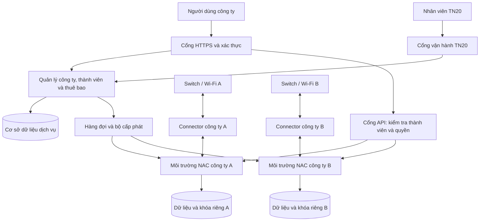

# Đặc tả NAC20 SaaS cho nhiều công ty độc lập

**Công Ty TNHH TN20 · 20.com.vn**

**Ngày:** 15/10/2026 · **Trạng thái:** thiết kế đề xuất để triển khai, chưa phải tính năng đã phát hành.

## 1. Mục tiêu và phạm vi

NAC20 SaaS cho phép nhiều công ty thuê dịch vụ kiểm soát truy cập mạng do TN20 vận hành. Khách hàng không cần tự quản lý máy chủ NAC trên Internet; họ quản lý thiết bị, chính sách và chi nhánh của mình qua trình duyệt. Mỗi địa điểm triển khai một hoặc nhiều Connector phù hợp với thiết kế mạng.

Một công ty là một khách hàng độc lập, gọi là `tenant` trong API và mô hình dữ liệu. Một công ty có nhiều người dùng, chi nhánh và Connector. Một người có thể được mời vào nhiều công ty nhưng phải chọn công ty đang thao tác. Quyền tại công ty A không tự áp dụng tại công ty B.

Quyết định kiến trúc: **cổng dịch vụ dùng chung; mỗi công ty có môi trường NAC riêng**, gồm dữ liệu, cấu hình, bộ nhớ đệm, hàng đợi, tài khoản kỹ thuật và khóa riêng. Giai đoạn đầu dùng máy ảo riêng cho từng công ty trên hạ tầng được quản lý chung. Đánh giá Kubernetes sau khi quy trình cấp phát, khôi phục và cách ly đã được kiểm chứng.

Tên miền đề xuất, cần được TN20 cấu hình DNS/TLS trước khi dùng:

| Địa chỉ | Chức năng |
|---|---|
| `saas.20.com.vn` | Đăng nhập, chọn công ty, quản lý thuê bao và tổng quan |
| `ops.20.com.vn` | Cổng vận hành dành cho TN20, giới hạn người truy cập |
| `<ma-cong-ty>.nac.20.com.vn` | Giao diện NAC và điểm kết nối dành riêng cho công ty |

Các địa chỉ trên chưa được tài liệu này tạo hoặc công bố hoạt động. Chưa có cam kết giá bán, số thiết bị tối đa hay SLA thương mại.

## 2. Hiện trạng mã nguồn và phần phải xây thêm

| Thành phần | Hiện trạng | Việc cần bổ sung |
|---|---|---|
| Giao diện NAC20 tiếng Việt | Đã có trong kho mã | Trang công ty, chi nhánh, thuê bao và quản trị TN20 |
| Thiết bị/MAC, vai trò và chính sách | Có trong từng môi trường NAC | Kết nối qua cổng API có kiểm tra công ty |
| Connector từ xa | Có quy trình ghép nối với ID và khóa | Mã đăng ký một lần, gắn công ty/chi nhánh, thu hồi và trạng thái |
| Phân quyền quản trị NAC | Có nền tảng quyền theo hành động | Thành viên theo công ty, quyền cổng SaaS, hỗ trợ có thời hạn |
| Cơ sở dữ liệu NAC | Bảng `node` dùng MAC làm khóa chính | Dùng DB riêng mỗi công ty; không dùng chung bảng thiết bị |
| Thành phần SaaS/Kubernetes | Có nhánh xử lý trong mã | Không đủ để tự tạo sản phẩm SaaS hoặc bảo đảm cách ly |
| Cấp phát, thuê bao, tính phí | Chưa được bộ cài hiện tại cung cấp | Xây dịch vụ quản lý và tác vụ nền |
| Bộ cài Debian 12 | Bản preview online | Chuẩn hóa thành bản nền đã nghiệm thu để cấp phát tự động |

Căn cứ mã nguồn: `db/pf-schema-X.Y.sql`, `lib/pf/UnifiedApi/Controller/Nodes.pm`, `lib/pf/UnifiedApi/Controller/SystemSummary.pm`, `lib/pf/admin_roles.pm`, `lib/pf/connector.pm`. Mục Domains của giao diện là miền Active Directory, không phải danh sách công ty thuê dịch vụ.

## 3. Nhu cầu của từng nhóm người dùng

| Nhóm | Công việc chính | Giới hạn |
|---|---|---|
| Chủ công ty | Mời thành viên, xem thuê bao, phê duyệt chính sách, yêu cầu xuất/xóa dữ liệu | Chỉ công ty của mình |
| Quản trị mạng công ty | Quản lý switch/Wi-Fi, MAC, VLAN/ACL, Connector và chính sách | Không quản lý hạ tầng TN20 |
| Nhân viên vận hành | Đăng ký/thu hồi thiết bị, xem lỗi theo quyền | Không tự tăng quyền hoặc xem khóa hệ thống |
| Người kiểm tra | Đọc báo cáo và lịch sử | Không sửa cấu hình |
| Bộ phận thanh toán | Xem gói dịch vụ, chứng từ và mức sử dụng | Không mặc định được xem MAC, nhật ký RADIUS hoặc khóa |
| Quản trị TN20 | Quản lý khách hàng, hạ tầng, cấp phát và tình trạng dịch vụ | Truy cập nội dung khách hàng qua quy trình hỗ trợ được ghi nhận |

MVP áp dụng phân quyền trong phạm vi toàn công ty. Nếu bán quyền quản trị chỉ một chi nhánh, phải bổ sung kiểm tra phạm vi chi nhánh tại API và kiểm thử đầy đủ; chưa đạt thì không cung cấp quyền này qua giao diện NAC gốc.

## 4. Kiến trúc triển khai

Hai nhóm dịch vụ có trách nhiệm khác nhau:

- Cổng dịch vụ quản lý khách hàng, đăng nhập, quyền, thuê bao, cấp phát và tình trạng hạ tầng.
- Môi trường NAC xử lý MAC, RADIUS, chính sách và kết nối mạng của một công ty.

Nếu cổng dịch vụ tạm ngừng, môi trường NAC đang hoạt động phải tiếp tục xử lý phiên và yêu cầu xác thực theo thiết kế đã nghiệm thu. Không đặt việc kiểm tra hóa đơn hoặc gọi cổng SaaS đồng bộ vào từng yêu cầu RADIUS.

Không cài nhiều bộ NAC lên cùng một hệ điều hành bằng cách đổi cổng: các dịch vụ, file cấu hình và mạng nội bộ có thể xung đột. Dùng ranh giới máy ảo riêng trong giai đoạn đầu. Hai máy ảo cùng host vẫn chịu rủi ro chung khi host hoặc vùng hạ tầng lỗi; chưa mặc nhiên có HA.

## 5. Chức năng cổng khách hàng

### 5.1. Tạo và chọn công ty

MVP: TN20 tạo khách hàng sau khi xác nhận thông tin, gửi lời mời cho chủ công ty; tự đăng ký công khai làm sau khi có chống lạm dụng và quy trình xác minh. Lời mời có thời hạn, dùng một lần, gắn email và công ty. Không cho người đăng ký tự nhận một công ty chỉ bằng cách nhập tên hoặc tên miền email.

Trang chọn công ty chỉ liệt kê nơi người dùng có tư cách thành viên. Chuyển công ty phải đổi ngữ cảnh và xóa dữ liệu/cache giao diện của công ty trước. Mã công ty không được tái sử dụng ngay sau khi xóa.

### 5.2. Trang tổng quan

Hiển thị: trạng thái dịch vụ, tổng thiết bị, thiết bị đã đăng ký, yêu cầu xác thực bị từ chối theo khoảng thời gian, Connector đang kết nối, chi nhánh, hạn thuê bao và cảnh báo cần xử lý. Mọi chỉ số ghi rõ thời điểm cập nhật và khoảng thời gian; không cộng số MAC từ nhiều chi nhánh thành số thiết bị duy nhất nếu chưa khử trùng đúng phạm vi công ty.

### 5.3. Chi nhánh và thiết bị mạng

Chi nhánh có mã, tên, múi giờ, địa chỉ liên hệ, mạng quản trị, Connector được gán và ghi chú. Switch/Wi-Fi có hãng/model, IP, chi nhánh và phương thức xác thực. Địa chỉ IP được phép trùng giữa các công ty; việc truy cập phải đi qua đúng môi trường và Connector.

### 5.4. Quản lý MAC và chính sách

Cho phép thêm MAC, nhập CSV/API hàng loạt, gán vai trò, thời hạn và ghi chú; thu hồi quyền, yêu cầu xác thực lại nếu thiết bị mạng hỗ trợ. Kiểm tra từng bản ghi nhập, chuẩn hóa MAC, hiển thị lỗi cụ thể; có xem trước trước khi ghi hàng loạt.

Vai trò mạng khác vai trò người quản trị. VLAN ID khác ID vai trò NAC. Chỉ thay đổi quyền truy cập khi người thao tác có quyền tương ứng. Một MAC được duyệt tại công ty A không tự được duyệt tại công ty B.

### 5.5. Thuê bao và mức sử dụng

Gói có các hạn mức dự kiến: môi trường NAC, chi nhánh, Connector, thiết bị đăng ký, thời gian giữ nhật ký và mức hỗ trợ. Giá và giới hạn cụ thể được xác định sau kiểm thử tải.

Đề xuất đo thiết bị theo số MAC đã đăng ký, chưa hết hạn và chưa xóa trong từng công ty tại thời điểm đo; nếu tính cước theo đỉnh hoặc theo tháng phải công bố quy tắc riêng. MAC ngẫu nhiên có thể làm tăng số đếm. Giới hạn tốc độ RADIUS và tài nguyên vận hành là thông số kỹ thuật riêng, không suy ra từ số MAC.

Khi vượt hạn mức, MVP cảnh báo và chặn thao tác đăng ký mới phù hợp hợp đồng; không tự thu hồi thiết bị đang được duyệt. Khi hết hạn, chuyển sang thời gian gia hạn và thông báo theo chính sách đã thỏa thuận. Không tự dừng xác thực mạng chỉ vì webhook thanh toán lỗi.

## 6. Mô hình dữ liệu cổng SaaS

Đây là thiết kế logic, chưa phải migration có thể chạy trên cơ sở dữ liệu NAC.

| Bảng | Trường chính và ràng buộc |
|---|---|
| `tenants` | UUID, mã duy nhất, tên công ty, trạng thái, thời điểm tạo |
| `users` | UUID, định danh đăng nhập, email xác minh, trạng thái MFA |
| `memberships` | `tenant_id`, `user_id`, vai trò, trạng thái; duy nhất theo cặp |
| `invitations` | Công ty, email, quyền được mời, hash token, hạn dùng, thời điểm sử dụng |
| `sites` | UUID, `tenant_id`, mã chi nhánh, tên và múi giờ |
| `environments` | UUID, `tenant_id`, endpoint nội bộ, phiên bản, trạng thái, tham chiếu bí mật |
| `connectors` | UUID, công ty, môi trường, chi nhánh, ID nền tảng, trạng thái và lần cuối liên lạc |
| `enrollment_tokens` | Hash mã đăng ký, công ty, chi nhánh, hạn dùng, trạng thái tiêu thụ |
| `plans` / `subscriptions` | Gói, hạn mức, chu kỳ, trạng thái và thời hạn hiệu lực |
| `usage_samples` | Công ty, loại số đo, thời điểm, giá trị và nguồn |
| `operations` | Công ty, loại tác vụ, khóa chống lặp, trạng thái, lỗi đã che bí mật |
| `audit_events` | Người thực hiện, công ty, hành động, đối tượng, thời gian và mã yêu cầu |
| `support_grants` | Công ty, nhân viên hỗ trợ, phạm vi, người duyệt và thời gian hết hạn |

MVP một môi trường hoạt động chính cho mỗi công ty. Các bản staging/khôi phục phải có loại riêng, không được vô tình nhận lưu lượng thật. Ràng buộc dữ liệu phải ngăn gắn chi nhánh công ty A với Connector công ty B; UUID không tự tạo ra cơ chế phân quyền.

Cơ sở dữ liệu cổng không chứa mật khẩu kỹ thuật/khóa Connector dạng rõ. Lưu tham chiếu đến kho bí mật; token đăng ký/lời mời lưu dạng hash. Dữ liệu MAC và RADIUS ở DB NAC của từng công ty; sao chép chỉ số tổng hợp khi cần, có phạm vi và thời hạn lưu.

## 7. Quy tắc cách ly bắt buộc

1. API xác thực danh tính, kiểm tra thành viên và quyền cho mỗi yêu cầu. `tenant_id` trong URL hoặc body chỉ xác định tài nguyên được yêu cầu, không phải bằng chứng được cấp quyền.
2. Chỉ định tuyến đến endpoint lấy từ danh mục môi trường đã được TN20 kiểm soát. Không nhận URL đích do trình duyệt cung cấp; chống gọi tùy ý vào mạng nội bộ.
3. Tên miền được ánh xạ qua danh mục đã xác minh, kiểm tra Host/SNI; tài khoản vẫn phải có quyền với công ty. Không tin header công ty do người dùng tự gửi.
4. Tài khoản API kỹ thuật riêng từng môi trường, quyền tối thiểu; không gửi tài khoản kỹ thuật xuống trình duyệt. Cổng phải kiểm tra từng thao tác và chỉ cho phép các API cần thiết, không mở proxy tùy ý.
5. Nếu cho dùng giao diện NAC gốc, dùng phiên đăng nhập NAC riêng có vai trò tương ứng. Không chuyển mọi người thành quản trị cao nhất. Phải nghiệm thu cơ chế đăng nhập/đăng xuất trước khi cam kết SSO.
6. Phiên và cookie giới hạn đúng host, tránh cookie dùng chung toàn miền `.20.com.vn`; kiểm tra CSRF, CORS, đổi công ty và đăng xuất. Không đưa token vào URL hoặc localStorage theo mặc định.
7. DB, Redis/cache, hàng đợi, volume, bản sao lưu và cấu hình tách theo môi trường. File xuất qua URL có thời hạn và kiểm tra quyền, không đặt thư mục tải công khai.
8. Mạng quản trị của các máy ảo không cho khách hàng truy cập chéo. Hạn mức CPU/RAM/đĩa và tốc độ yêu cầu ngăn một công ty làm cạn tài nguyên chung.
9. Khóa đường hầm, khóa RADIUS và chứng thư tách theo công ty. Việc ghép Connector không cho phép tùy ý chọn công ty/môi trường đích sau khi xác minh mã.
10. Tài khoản hỗ trợ TN20 không mặc định truy cập nội dung mọi công ty. Cấp quyền theo thời gian, lý do và phạm vi, có nhật ký; quyền khẩn cấp cần quy trình riêng được theo dõi.

## 8. Cấp phát môi trường tự động

Luồng trạng thái: `requested → provisioning → configuring → verifying → ready`. Khi lỗi chuyển `failed` kèm bước lỗi và khả năng thử lại; tạm dừng, xóa và khôi phục là các tác vụ riêng.

Trình tự thực hiện:

1. Xác nhận khách hàng, gói và đủ tài nguyên; ghi một tác vụ có khóa chống lặp.
2. Cấp máy ảo Debian 12 từ bản nền đã nghiệm thu, đặt mạng quản trị và giới hạn tài nguyên.
3. Sinh khóa/tài khoản riêng, lưu kho bí mật; cấp DB, đĩa và chính sách sao lưu cho môi trường.
4. Cài đúng phiên bản NAC20 cùng manifest/tổng kiểm đã chốt; không tự kéo bản mới nhất khi chạy lại tác vụ.
5. Cấu hình hostname, múi giờ, tiếng Việt, DNS/TLS và API kỹ thuật. Tự động hóa cấu hình lần đầu phải được xây và kiểm thử; bộ cài preview hiện chưa cung cấp toàn bộ bước này.
6. Cấu hình chỉ các đường mạng cần thiết, giám sát, nhật ký và sao lưu.
7. Kiểm tra API, tình trạng dịch vụ, TLS, ràng buộc công ty và một luồng xác thực thử phù hợp môi trường.
8. Công bố trạng thái `ready`, cho phép chủ công ty nhận lời mời và đăng ký Connector.

Thử lại phải tiếp tục có kiểm soát, không tạo thêm máy ảo hay ghi đè khóa đang dùng. Mỗi bước lưu trạng thái, mã tài nguyên và kết quả; không ghi bí mật vào log. Nếu lỗi sau khi cấp tài nguyên, giữ trạng thái cách ly để chẩn đoán rồi dọn theo chính sách; không tự xóa môi trường đang phục vụ khách hàng.

Bộ cài hiện dùng một số ảnh runtime theo nhãn `latest`; trước khi dùng làm nền SaaS phải chốt digest và thử khả năng khôi phục đúng phiên bản. Chỉ thêm digest vào tài liệu chưa làm runtime trở thành bất biến.

## 9. Ghép Connector bằng mã đăng ký một lần

Trải nghiệm mục tiêu: quản trị viên chọn chi nhánh → tạo mã đăng ký → chạy lệnh trên máy Connector → xác nhận Connector trên cổng → kiểm tra RADIUS.

Mã do máy chủ sinh ngẫu nhiên đủ mạnh, hạn dùng đề xuất 10 phút, chỉ dùng một lần và chỉ gắn một công ty/chi nhánh. Có giới hạn số lần thử, khóa chống lạm dụng và giao dịch tiêu thụ nguyên tử để hai máy không dùng được cùng mã.

Máy Connector chỉ gửi mã qua HTTPS đến điểm đăng ký đã tin cậy. Máy chủ trả về cấu hình của đúng môi trường và bí mật riêng; không trả khóa công ty khác theo tham số do agent yêu cầu. Ưu tiên nhập mã tương tác hoặc file quyền 0600, không để mã/bí mật trong tham số tiến trình, lịch sử shell hay đường dẫn URL.

Đây là **dịch vụ đăng ký và công cụ bootstrap cần viết thêm**. Quy trình hiện có vẫn ghép bằng ID/khóa; chưa có lệnh đăng ký SaaS để người dùng chạy. Không dùng cú pháp lệnh giả trong hướng dẫn cài đặt thực tế.

Vòng đời Connector gồm: chờ đăng ký, chờ duyệt, trực tuyến, mất kết nối, thu hồi. Thu hồi phải vô hiệu hóa thông tin xác thực và đóng đường hầm phía máy chủ; không chỉ đổi nhãn trạng thái. Thử nghiệm khả năng đổi khóa, chuyển chi nhánh và khôi phục máy. Sao chép đĩa Connector không được tạo bản sao có quyền hoạt động lâu dài ngoài kiểm soát.

## 10. API cổng SaaS đề xuất

Các đường dẫn dưới đây là hợp đồng thiết kế, **chưa tồn tại trong NAC20 hiện tại**. Dùng tiền tố `/saas/api/v1` để phân biệt `/api/v1` của từng môi trường NAC.

| Phương thức và đường dẫn | Mục đích | Quyền tối thiểu |
|---|---|---|
| `GET /saas/api/v1/me/tenants` | Danh sách công ty được tham gia | Người dùng đã xác thực |
| `POST /saas/api/v1/tenants` | Tạo khách hàng | TN20 quản lý khách hàng |
| `GET /saas/api/v1/tenants/{t}/overview` | Tổng quan của công ty | Người xem |
| `POST /saas/api/v1/tenants/{t}/invitations` | Mời thành viên | Chủ công ty/quản trị thành viên |
| `POST /saas/api/v1/tenants/{t}/sites` | Tạo chi nhánh | Quản trị mạng |
| `POST /saas/api/v1/tenants/{t}/environments` | Yêu cầu cấp phát | TN20 cấp phát |
| `GET /saas/api/v1/tenants/{t}/operations/{id}` | Xem kết quả tác vụ | Người có quyền với tác vụ |
| `POST /saas/api/v1/tenants/{t}/connector-enrollments` | Tạo mã đăng ký | Quản trị mạng |
| `POST /saas/api/v1/connector-enrollments/redeem` | Đổi mã lấy cấu hình | Máy có mã hợp lệ, giới hạn tốc độ |
| `POST /saas/api/v1/tenants/{t}/connectors/{id}/revoke` | Thu hồi Connector | Quản trị mạng |
| `POST /saas/api/v1/tenants/{t}/nodes/import-preview` | Kiểm tra dữ liệu MAC | Người vận hành thiết bị |
| `POST /saas/api/v1/tenants/{t}/nodes/import` | Thực hiện nhập MAC | Người có quyền cấp truy cập |
| `GET /saas/api/v1/tenants/{t}/subscription` | Xem thuê bao | Chủ công ty/thanh toán |
| `POST /saas/api/v1/tenants/{t}/support-grants` | Cấp quyền hỗ trợ có hạn | Chủ công ty |

Tạo môi trường, nhập hàng loạt và thu hồi trả mã tác vụ khi xử lý nền. Yêu cầu thay đổi quan trọng có khóa chống lặp, chống cập nhật cấu hình cũ và audit. Danh sách có phân trang, giới hạn số lượng và lọc phía máy chủ. Không trả lỗi làm lộ tài nguyên công ty khác; chọn quy tắc 403/404 thống nhất.

Webhook thanh toán cần xác thực nguồn, chống phát lại và xử lý lặp an toàn; chưa tích hợp nhà cung cấp thanh toán cụ thể. Mọi giá trị thuê bao có hiệu lực được cập nhật từ trạng thái giao dịch đã đối soát.

## 11. Giao diện cần bổ sung

**Khách hàng:** chọn công ty; tổng quan; chi nhánh; Connector; thiết bị/MAC; chính sách; nhật ký; thành viên; thuê bao; yêu cầu hỗ trợ. Mỗi trang luôn hiển thị công ty đang thao tác. Trước khi thu hồi MAC/Connector hoặc áp dụng chính sách hàng loạt, hiển thị phạm vi và tác động thực tế.

**TN20:** danh sách khách hàng; trạng thái cấp phát; mức sử dụng hạ tầng; tác vụ lỗi; phiên bản môi trường; sao lưu/khôi phục; thuê bao; quyền hỗ trợ và audit. Tách quyền vận hành hạ tầng với quyền xem nội dung khách hàng.

Tiếng Việt mặc định; ngày giờ theo múi giờ hiển thị, lưu thời gian chuẩn ở máy chủ. Màn hình lỗi đưa mã yêu cầu để hỗ trợ tra cứu; không hiện stack trace, mật khẩu hoặc khóa. Bản demo phải ghi rõ dữ liệu mẫu và không cho hiểu nhầm rằng thao tác đã thay đổi mạng thật.

## 12. Sao lưu, nâng cấp và xử lý sự cố

Sao lưu theo công ty gồm DB, cấu hình, chứng thư và tham chiếu phiên bản; mã hóa và hạn chế quyền đọc/xóa. Khôi phục trước vào môi trường cách ly, không nối Connector thật cho tới khi xác nhận. Xuất dữ liệu cho khách hàng phải kiểm tra quyền và phạm vi.

Mỗi môi trường có cửa sổ bảo trì. Nâng cấp thử trên bản khôi phục trước, rồi một khách hàng pilot, sau đó mới mở rộng. Rollback phải xem xét cả schema DB và dữ liệu phát sinh; không giả định đổi về ảnh cũ là đủ.

Giám sát tình trạng dịch vụ, độ trễ/tỷ lệ lỗi RADIUS, đường hầm, lỗi CoA, CPU/RAM/đĩa, hạn chứng thư, hàng đợi và tuổi bản sao lưu. Nhật ký tập trung có nhãn công ty nhưng chỉ người có quyền mới được truy vấn. Quy định thời gian giữ log và xóa dữ liệu ở từng tầng, kể cả bản sao lưu, trước khi ký thuê bao.

Mất Internet tại chi nhánh: hành vi phiên đang có và xác thực mới tùy thiết bị/chính sách. Connector chưa được chứng minh là máy chủ xác thực offline độc lập. Muốn bán chế độ này phải thiết kế engine/chính sách tại chỗ và thử đồng bộ, thu hồi quyền, xung đột và mất kết nối riêng.

RPO/RTO và SLA phải được chọn theo gói, tài nguyên và kết quả diễn tập; chưa đưa con số cam kết trước khi đo. Khách hàng quan trọng có thể cần dự phòng môi trường NAC, đường Internet và Connector theo khả năng nền tảng đã thử.

## 13. Tiêu chí nghiệm thu bắt buộc

| Mã | Tình huống | Điều kiện đạt |
|---|---|---|
| ISO-01 | A thay UUID/tenant trong URL, body hoặc header thành B | Không đọc/sửa tài nguyên B; có log phù hợp |
| ISO-02 | Hai công ty cùng MAC và cùng IP switch | Có bản ghi và quyết định mạng độc lập |
| ISO-03 | Cùng lúc dùng hai phiên công ty khác nhau | Không trộn cache, file xuất, cookie hoặc kết quả tìm kiếm |
| ISO-04 | Thử truy cập chéo DB, mạng quản trị và bản sao lưu | Bị từ chối ở lớp phù hợp |
| IAM-01 | Thu hồi thành viên hoặc quyền hỗ trợ | Phiên/token mất quyền trong thời hạn đã thiết kế |
| CON-01 | Mã hết hạn, dùng lại, hai máy dùng đồng thời | Không phát thêm thông tin xác thực trái phép |
| CON-02 | Thu hồi Connector đang trực tuyến | Đường hầm bị đóng, không tái kết nối bằng khóa cũ |
| NET-01 | MAC duyệt/không duyệt, VLAN/ACL và CoA | Thiết bị thật thực thi đúng; lệnh A không tác động B |
| PRO-01 | Gửi lặp yêu cầu cấp phát, tác vụ lỗi giữa chừng | Không tạo trùng, không ghi đè hoặc công bố môi trường lỗi |
| OPS-01 | Cổng SaaS hoặc dịch vụ thanh toán ngừng | NAC đang chạy không bị phụ thuộc đồng bộ ngoài thiết kế |
| OPS-02 | Khôi phục riêng một công ty | Đúng dữ liệu, phiên bản và phạm vi, không ảnh hưởng công ty khác |
| LIM-01 | Một công ty tải cao/vượt hạn mức | Tài nguyên và thao tác bị giới hạn theo chính sách đã đo |
| LIFE-01 | Hết hạn, gia hạn, tạm dừng và chấm dứt | Có thông báo, audit; không tự cắt mạng ngoài thỏa thuận |

Kiểm thử sử dụng thiết bị mạng thật hoặc phòng lab tương đương cho MAB/CoA. Kiểm tra giao diện và APT mô phỏng không thay thế nghiệm thu RADIUS. Thử tải phải đo xác thực/giây, accounting, số phiên, dung lượng log và độ trễ WAN; số công ty tối đa không thể suy ra chỉ từ RAM.

## 14. Lộ trình và sản phẩm bàn giao

| Giai đoạn | Công việc | Điều kiện chuyển bước |
|---|---|---|
| 0 — Chuẩn hóa NAC | Cài mới thực tế, nghiệm thu Connector/MAB/CoA, chốt runtime, thử sao lưu | Một môi trường hoạt động và phục hồi được |
| 1 — Nền tảng SaaS | Công ty, thành viên, MFA, quyền, audit, cổng API | ISO-01/03 và IAM-01 đạt |
| 2 — Cấp phát | Máy ảo, bí mật, DNS/TLS, tác vụ thử lại, giám sát | PRO-01 và khôi phục môi trường đạt |
| 3 — Khách hàng tự quản | Tổng quan, chi nhánh, nhập MAC, đăng ký/thu hồi Connector | ISO-02/04, CON và NET đạt với hai công ty |
| 4 — Thuê bao pilot | Hạn mức, thời gian gia hạn, hỗ trợ, hướng dẫn, vận hành | OPS, LIM, LIFE đạt; pilot có giám sát |
| 5 — Mở rộng | Thanh toán tự động, tối ưu mật độ, dự phòng, đánh giá Kubernetes | Có số đo tải và nhu cầu kinh doanh thực tế |

Mỗi giai đoạn bàn giao mã nguồn, migration, API, cấu hình triển khai, tài liệu vận hành và bằng chứng kiểm thử tương ứng. Thời gian/chi phí chỉ lập sau khi chốt hạ tầng, nhân lực, số khách hàng pilot và mức sẵn sàng yêu cầu; không cam kết bằng số tuần chưa có căn cứ.

Phạm vi MVP đề xuất: TN20 tạo khách hàng, một môi trường mỗi công ty, nhiều thành viên/chi nhánh, Connector có mã đăng ký, quản lý MAC, nhật ký, thuê bao và sao lưu. Chưa gồm thanh toán tự động, phân quyền riêng từng chi nhánh, SSO doanh nghiệp, xác thực offline hoặc HA nhiều vùng.

## 15. Các quyết định cần chốt khi bắt đầu triển khai

- Số khách hàng pilot; số MAC, chi nhánh và tải RADIUS dự kiến mỗi công ty.
- Hạ tầng ảo hóa/cloud, vùng đặt dữ liệu, tên miền và hệ thống quản lý bí mật.
- Quyền khách hàng được dùng trực tiếp trên NAC gốc và phần chỉ dùng qua cổng SaaS.
- Chính sách thời gian giữ log, sao lưu, khôi phục, hỗ trợ và chấm dứt dịch vụ.
- Cách tính hạn mức/giá, thời gian gia hạn, người có thẩm quyền phê duyệt thao tác có thể gián đoạn mạng.

Các quyết định này không ngăn việc xây nền tảng công ty/thành viên và kiểm thử cách ly trong lab, nhưng phải chốt trước khi cấp dịch vụ thật. Tài liệu này bổ sung thiết kế sản phẩm; bộ cài preview và trang xem thử hiện tại chưa được biến thành SaaS chỉ bằng việc thêm tài liệu.
